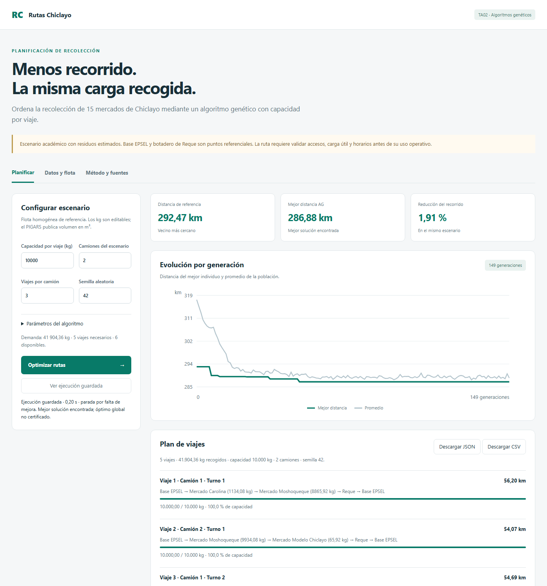
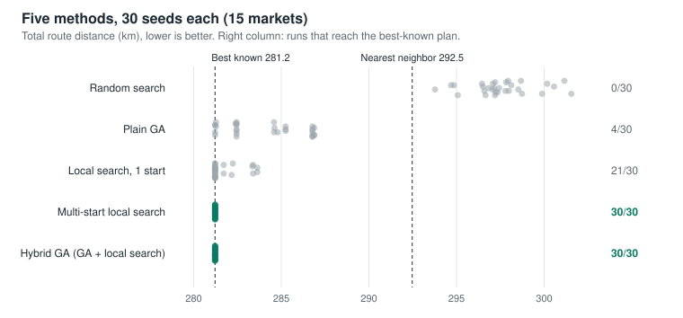
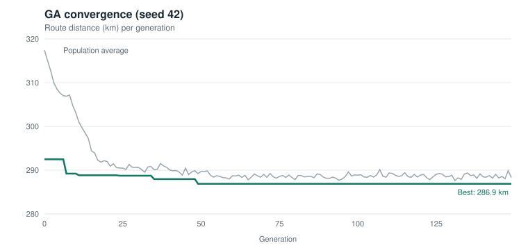

# Waste-collection routing for 15 markets in Chiclayo, Peru

[](https://github.com/williares162003-lab/rutas-recoleccion-chiclayo/actions/workflows/tests.yml)

A **genetic algorithm and a hybrid GA + local search, written from scratch in pure Python**, that plan garbage-collection trips for 15 real public markets in Chiclayo, Peru. They run on a real directed road network and respect truck capacity, with split pickups and multiple trips per truck.

No optimization or ML libraries are used: no DEAP, PyGAD, NumPy, SciPy or external solvers. The operators, decoder, local search, exact enumeration and statistical test are hand-written.



## Highlights

| | |
|---|---|
| **Exact validation** | On 25 sub-instances (6 to 10 markets, up to **3,628,800** possible orders), every order was enumerated. The hybrid GA found the exact optimum in **25/25**, evaluating as little as **0.07 %** of the orders. The plain GA found it in 20/25, with a worst gap of 0.61 %. |
| **Full instance (15 markets)** | Best-known plan **281.2 km**, vs. **292.5 km** for a nearest-neighbor baseline (**−3.8 %**). The hybrid GA reaches it in **30/30** seeds, in ~0.5 s per run. |
| **Benchmark** | 5 methods × 30 seeds, compared with a one-sided Mann-Whitney U test. The GA beats budget-matched random search (p < 10⁻¹⁰). The hybrid beats the plain GA (p < 10⁻¹⁰). |
| **Honest finding** | At this size, **local search is what drives the result**: multi-start local search with the same budget also reaches the best-known plan in 30/30 runs. See [what the benchmark shows](#what-the-benchmark-shows). |
| **Reproducibility** | Fixed seeds, SHA-256-fingerprinted data, 19 automated tests run in CI on Python 3.10–3.13, and scripts that regenerate every number in this README. |

## The problem

Each day the 15 selected markets (in Chiclayo, José Leonardo Ortiz and La Victoria) produce an estimated **41,904 kg** of waste. One market, Moshoqueque, alone produces 18,800 kg, more than a full truck.

The scenario models:

- **Capacity:** 10,000 kg per truck per trip, 2 trucks, up to 3 trips per truck.
- **Trip structure:** depot → markets → landfill → depot.
- **Split pickups:** if a market's remaining waste does not fit, it is collected over consecutive trips.
- **Directed distances:** A→B can differ from B→A (one-way streets).
- **Objective:** minimize total distance driven.

In routing terms, this is a split-delivery, multi-trip capacitated vehicle routing problem on an asymmetric network.

## How the algorithm works

| Step | What it does |
|---|---|
| **Encoding** | A chromosome is a permutation of the 15 market IDs: the order in which markets are served. |
| **Decoder** | Turns an order into capacity-feasible trips. It fills each truck, closes the trip at the landfill, returns to the depot, and splits a market's load across trips when needed. Trips are assigned to trucks cyclically. |
| **Fitness** | Total directed road distance of the decoded plan (fitness = 1 / (1 + km)). |
| **Initial population** | 100 individuals: the nearest-neighbor solution plus 99 random permutations. |
| **Selection** | Tournament of 3. |
| **Crossover** | Order crossover (OX), probability 0.9. It keeps every market exactly once. |
| **Mutation** | Swap mutation, probability 0.2. |
| **Local search** (hybrid only) | With probability 0.02, an offspring is improved by first-improvement local search over two neighborhoods: **2-opt** (reverse a segment of the order) and **relocate** (move one market to another position). It stops at a local optimum. It never worsens a solution and stays inside the decoder's constraints. |
| **Replacement** | Elitism: the 2 best individuals survive unchanged. |
| **Stopping** | 500 generations, or 100 generations without improvement. |
| **Cache** | Identical chromosomes are not re-evaluated. |

All of it lives in one readable file, [`src/algoritmo_genetico/motor_genetico.py`](src/algoritmo_genetico/motor_genetico.py). Start at `optimizar` and follow steps 0–7. With `prob_busqueda_local = 0` (the default) the engine reproduces the original GA exactly, and a test checks this.

## Results

### Benchmark: 5 methods × 30 seeds



| Method | Best | Median | Worst | Std. dev. | Reaches best-known | Distinct evaluations | Time / run |
|---|---|---|---|---|---|---|---|
| Nearest neighbor (deterministic) | 292.47 | — | — | — | — | 1 | — |
| Random search (same budget as GA) | 293.77 | 297.29 | 301.55 | 1.82 | 0/30 | 1,810 | 0.05 s |
| Plain GA | 281.22 | 284.58 | 286.88 | 2.22 | 4/30 | 1,810 | 0.25 s |
| Local search, 1 random start | 281.22 | 281.22 | 283.63 | 0.86 | 21/30 | 881 | 0.02 s |
| Multi-start local search (same budget as hybrid) | 281.22 | 281.22 | 281.22 | 0.00 | **30/30** | 14,049 | 0.30 s |
| **Hybrid GA** | 281.22 | 281.22 | 281.22 | 0.00 | **30/30** | 13,790 | 0.53 s |

All distances are in km. One-sided Mann-Whitney U tests:

| Comparison | p-value |
|---|---|
| Plain GA < random search | 1.4 × 10⁻¹¹ |
| Hybrid GA < plain GA | 9.0 × 10⁻¹¹ |
| Hybrid GA < local search with 1 start | 6.8 × 10⁻⁴ |
| Hybrid GA < multi-start local search | 1.0 (no difference) |

### What the benchmark shows

- **The GA learns.** With the same number of evaluations, random search does worse than the nearest-neighbor heuristic, while the GA beats it in every run.
- **Local search is the key ingredient at this size.** A single local search from a random order already beats the plain GA. Adding it to the GA makes the result fully reliable (30/30).
- **The GA component adds no measurable value at 15 markets.** Restarting local search from random orders with the same budget is just as reliable. The search space inside the decoder (15! ≈ 1.3 × 10¹²) is large but easy for these neighborhoods. Larger instances are where a hybrid should pull ahead; that is future work.
- 281.2 km is the **best known**, not a proven optimum, for the 15-market instance.

### Exact validation on small instances



| Markets | Possible orders | Exact optimum | Plain GA gap | Hybrid GA gap | Share evaluated by hybrid |
|---|---|---|---|---|---|
| 6 | 720 | 217.47 km | 0.000 % | 0.000 % | 49.9 % |
| 7 | 5,040 | 217.66 km | 0.000 % | 0.000 % | 15.1 % |
| 8 | 40,320 | 221.31 km | 0.000 % | 0.000 % | 3.0 % |
| 9 | 362,880 | 223.27 km | 0.033 % | 0.000 % | 0.61 % |
| 10 | 3,628,800 | 224.73 km | 0.000 % | 0.000 % | **0.07 %** |
| 20 random groups of 8 | 40,320 each | — | 16/20 optimal (worst 0.61 %) | **20/20 optimal** | 3.3 % on average |

Enumeration covers every order the decoder can receive. So it certifies the optimum **within the decoder's solution space**, not for the general split-delivery problem.

Raw outputs are in [`resultados/`](resultados/): `experimento_comparativo.json/.csv`, `validacion_exacta.json`, one JSON per seed of the original 10-seed experiment, the convergence history and the trip plan.

## Data

| File | Content |
|---|---|
| `datos/15_mercados_chiclayo_11_columnas.csv` | 15 markets: name, district, fixed stalls, estimated kg/day, coordinates |
| `datos/matriz_distancias_m.csv`, `datos/matriz_vial.json` | 17×17 directed road-distance matrix (15 markets + depot + landfill), in meters |
| `datos/fuentes/osrm_final.json` | Original OSRM Table API response (car profile, queried 2026-10-15) and the query used |
| `datos/flota_publicada.csv` | Fleet listed in the municipal waste plan (PIGARS 2026–2030, table 84) |
| `datos/configuracion.json` | Capacity, fleet and GA parameters |
| `datos/auditoria.json` | SHA-256 fingerprint and checks of the market dataset |

**How demand was estimated:** Moshoqueque's reference of 18,800 kg/day (municipal record, 2023) divided by its 3,647 fixed stalls gives 5.155 kg per stall per day. That rate is applied to every market's stall count. These are **estimates, not current weighings**.

**Sources:**
- Road distances from [OSRM](https://project-osrm.org/), using map data © [OpenStreetMap contributors](https://www.openstreetmap.org/copyright) (ODbL).
- Fleet data from the [Chiclayo PIGARS 2026–2030](https://www.gob.pe/institucion/munichiclayo/normas-legales/7732781-000001-2026-mpch-a).
- Market list from the [DePerú market directory](https://www.deperu.com/mercados/provincia_chiclayo_lambayeque.html).

## Run it

Requires Python 3.10 or newer. Nothing to install.

```bash
python src/main.py
```

Then open http://127.0.0.1:8765. Use **Optimizar rutas** to run the GA live, or **Ver ejecución guardada** to load the saved run. If the port is busy, add `--puerto 8766`.

```bash
python -m unittest discover -s tests -v      # 19 tests (~1 s)
python scripts/experimento_comparativo.py    # 5 methods x 30 seeds (~1 min)
python scripts/validacion_exacta.py          # exact check on 25 sub-instances (~2 min)
python scripts/experimento.py                # original 10-seed experiment
python scripts/make_charts.py                # regenerates the README charts
```

The tests cover capacity and coverage constraints, split pickups, gene preservation in OX, mutation and local search, invalid inputs, mass precision, elitism, reproducibility of both versions, backward compatibility with the saved run, and an exact oracle on a small synthetic case.

## Project structure

```
src/
  algoritmo_genetico/motor_genetico.py   GA, local search, decoder, tournament, OX, swap, elitism
  sistema/lector_datos.py                data loading and validation
  main.py                                local web server (standard library)
  templates/ static/                     web interface
datos/                                   input data and original sources
resultados/                              experiment outputs
tests/test_sistema.py                    automated tests
scripts/                                 benchmark, exact check, experiment and chart scripts
notebooks/                               Google Colab version (original GA)
docs/img/                                README images
.github/workflows/tests.yml              CI: tests on Python 3.10–3.13
```

Code comments and the interface are in Spanish.

## Limitations

- Waste quantities are estimated from stall counts, not measured.
- The depot and landfill points are reference locations; truck access gates were not validated in the field.
- Distances use a car profile, with no live traffic and no truck restrictions.
- The 10,000 kg capacity and the 2 trucks × 3 trips fleet are scenario assumptions, not an official assignment.
- The decoder restricts the search space: it finishes a market before moving on and fills every trip except the last. The number of trips is fixed by total demand. A better trip-splitting procedure, such as Prins' *Split*, could reach plans the current decoder cannot.
- Only distance is minimized. Schedules, working hours and balance between trucks are not optimized.

## Credits

The original GA was developed as a team project for the *Intelligent Systems Development* course (2026-II), Universidad Católica Santo Toribio de Mogrovejo (USAT), Chiclayo, Peru. The hybrid local search, exact validation, benchmark and CI were added afterwards in this public version.

Algorithmic references: Hamontree, Koiwanit & Sinchai (2026, *Frontiers in Sustainability*); Assaf & Saleh (2017, *Civil and Environmental Engineering Reports*); Karadimas, Papatzelou & Loumos (2007, AIAI); Prins (2004, *Computers & Operations Research*) for the Split idea mentioned as future work.
